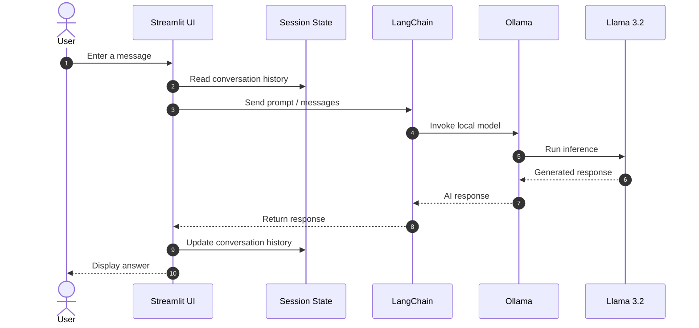
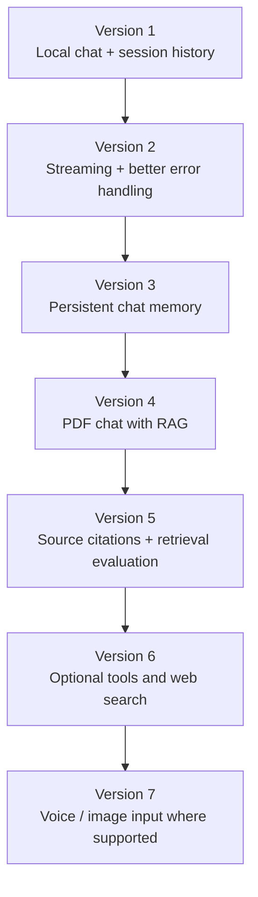

<div align="center">.....

# 🤖 Vedant's AI Chatbot..

### Your private, local AI assistant — powered by Streamlit, LangChain, Ollama, and Llama 3.2

[](https://www.python.org/)
[](https://streamlit.io/)
[](https://www.langchain.com/)
[](https://ollama.com/)
[](https://ollama.com/library/llama3.2)
[](https://ollama.com/)

**Chat with an AI model on your own machine. No cloud LLM API key is required for the local Ollama setup.**

</div>

---

## 🖼️ Project at a glance

```mermaid
flowchart LR..
    U(["👤 You"]) --> UI["Streamlit chat UI"]
    UI --> SS["Session State<br/>Conversation history"]
    SS --> LC["LangChain"]
    LC --> O["Ollama runtime"]
    O --> M["Llama 3.2"]
    M --> O --> LC
    LC --> UI
    UI --> U
```

> **Privacy note:** The model runs locally through Ollama, so prompts can stay on your machine when you use the local model and do not add external services. Your app still depends on your local machine, installed model, and any integrations you choose to add.

## ✨ Features

- 💬 Chat-style interface built with Streamlit
- 🧠 Llama 3.2 served locally through Ollama
- 🔗 LangChain integration for model interaction
- 📝 Conversation history stored in Streamlit Session State
- 🔄 Multi-turn conversation during the active session
- 🗑️ Clear-chat functionality
- 🖥️ Local inference without a hosted LLM API
- 🎨 Lightweight web UI that runs in your browser

> Features listed here reflect the supplied project description. Streaming, persistent chat history, PDF/RAG, voice, image understanding, and web search are listed below as possible future enhancements—not as implemented features.

## 🧭 How the chatbot works



### What each component does

| Component | Responsibility |
|---|---|
| **Streamlit** | Renders the chat interface and handles user interactions |
| **Session State** | Keeps conversation data during the active Streamlit session |
| **LangChain** | Provides the model integration abstraction |
| **Ollama** | Downloads, serves, and runs the local model |
| **Llama 3.2** | Generates responses to user messages |

**Important distinction:** Streamlit Session State is session-scoped. It does not automatically provide permanent conversation storage across browser sessions or application restarts.

## 🧰 Tech stack

| Technology | Purpose | Documentation |
|---|---|---|
| Python | Application logic | [python.org](https://www.python.org/) |
| Streamlit | Chat interface | [Docs](https://docs.streamlit.io/) |
| LangChain | Model orchestration / integration | [Docs](https://docs.langchain.com/) |
| `langchain-ollama` | LangChain integration for Ollama | [Integration docs](https://docs.langchain.com/oss/python/integrations/chat/ollama) |
| Ollama | Local model runtime | [ollama.com](https://ollama.com/) |
| Llama 3.2 | Local language model | [Model library](https://ollama.com/library/llama3.2) |

---

## 🚀 Quick start

### 1. Clone the repository

Replace the placeholder repository URL with your actual GitHub repository URL.

```bash
git clone https://github.com/YOUR_USERNAME/Vedants-AI-Chatbot.git
cd Vedants-AI-Chatbot
```

### 2. Create a virtual environment

```bash
python -m venv .venv
```

Activate it:

**Windows PowerShell**

```powershell
.venv\Scripts\Activate.ps1
```

**Windows Command Prompt**

```bat
.venv\Scripts\activate.bat
```

**macOS / Linux**

```bash
source .venv/bin/activate
```

### 3. Install Ollama

Download and install Ollama from:

**https://ollama.com/download**

### 4. Download the model

```bash
ollama pull llama3.2
```

Confirm it is installed:

```bash
ollama list
```

You can test the model directly:

```bash
ollama run llama3.2
```

Type a prompt in the Ollama terminal. Use `/bye` to exit the interactive session.

### 5. Install Python dependencies

If the repository contains `requirements.txt`:

```bash
python -m pip install --upgrade pip
pip install -r requirements.txt
```

A minimal dependency list for the described stack is:

```text
streamlit
langchain
langchain-ollama
```

Save those lines as `requirements.txt` if they match your `app.py` imports. Add other packages only if your code actually uses them. The separate Python `ollama` package is not required for every LangChain integration.

### 6. Start the app

Make sure Ollama is running, then run:

```bash
streamlit run app.py
```

Streamlit normally prints a local URL such as `http://localhost:8501`. Open that address in your browser if it does not open automatically.

---

## 📂 Project structure

```text
Vedants-AI-Chatbot/
├── app.py                 # Streamlit application
├── requirements.txt       # Python dependencies
├── README.md              # Project documentation
├── .gitignore             # Files Git should ignore
└── screenshots/           # Optional: add real app screenshots here
    └── chatbot-demo.png
```

Your actual repository may have a different structure. Keep the README aligned with the files that exist in your project.

### Recommended `.gitignore`

```gitignore
.venv/
__pycache__/
*.py[cod]
.env
.env.*
!.env.example
.streamlit/secrets.toml
.pytest_cache/
```

Do not commit credentials or private configuration.

## 💬 Example conversation

The following is an illustrative example of the intended chat experience, not a screenshot or a claim about a specific model output.

```text
┌──────────────────────────────────────────┐
│  🤖 Vedant's AI Chatbot                  │
├──────────────────────────────────────────┤
│ You                                      │
│ What is machine learning?                │
│                                          │
│ 🤖 Assistant                             │
│ Machine learning is a branch of AI that  │
│ enables systems to learn patterns from   │
│ data and use them to make predictions    │
│ or decisions without hand-coding every   │
│ rule.                                    │
├──────────────────────────────────────────┤
│ Message: [ Ask me anything...        ➤ ] │
└──────────────────────────────────────────┘
```

### Add real screenshots for a stronger GitHub page

1. Run the app locally.
2. Capture the actual browser UI.
3. Save the screenshot as `screenshots/chatbot-demo.png`.
4. Add this Markdown where you want the screenshot to appear:

```markdown

```

A real screenshot is more useful than a placeholder because visitors can see the actual UI you built.

---

## 🧠 Concepts demonstrated

- Streamlit app structure and chat components
- Session State for active-session conversation history
- LangChain model integration
- Local inference with Ollama
- LLM prompts and generated responses
- Python virtual environments and dependency management
- Running and testing a local AI application

## 🔧 Troubleshooting

| Problem | What to try |
|---|---|
| `streamlit` command not found | Activate `.venv`, then run `python -m pip install streamlit` |
| Ollama connection error | Start Ollama and verify it is available locally |
| Model not found | Run `ollama pull llama3.2`, then check `ollama list` |
| Import error for `ChatOllama` | Install `langchain-ollama` in the active environment |
| App runs but answers slowly | Check available RAM/VRAM, model size, and other running processes |
| Chat history disappears after restart | Expected with session-only state; implement persistence if needed |
| Wrong Python environment | Run `python -c "import sys; print(sys.executable)"` and verify the active interpreter |
| Port is already in use | Use `streamlit run app.py --server.port 8502` |

### Quick environment check

```bash
python --version
python -m pip show streamlit langchain langchain-ollama
ollama list
```

## 🛣️ Future roadmap

These are ideas for future versions, not claims about the current implementation.



| Priority | Enhancement | What you would learn |
|---|---|---|
| 1 | Streaming responses | Streamlit UX and incremental output |
| 2 | Persistent chat history | SQLite or PostgreSQL |
| 3 | PDF chat with RAG | Parsing, chunking, embeddings, vector search |
| 4 | Source citations | Grounded generation and retrieval evaluation |
| 5 | Model selector | Model configuration and runtime validation |
| 6 | Export conversation | File handling and data formats |
| 7 | Optional web search | Tool calling and external data boundaries |
| 8 | Voice interface | Speech-to-text and text-to-speech integration |
| 9 | Image understanding | Compatible vision model and image pipeline |
| 10 | Tests and observability | Reliability, debugging, and evaluation |

## 🔒 Privacy and limitations

- The model is run locally through Ollama; no hosted LLM API key is required for this local setup.
- Model downloads require internet access initially.
- Actual speed depends on hardware, model size, quantization, and available memory.
- Session State is not permanent storage.
- Adding web search or external integrations changes the data-flow and privacy assumptions.
- A local model can still generate inaccurate or misleading responses; verify important information.

## 📖 Recommended learning resources

### Start here

1. [Streamlit — Get started](https://docs.streamlit.io/get-started)
2. [Streamlit — Chat elements](https://docs.streamlit.io/develop/api-reference/chat)
3. [Streamlit — Session State](https://docs.streamlit.io/develop/api-reference/caching-and-state/st.session_state)
4. [Ollama — Official documentation](https://docs.ollama.com/)
5. [Ollama — Llama 3.2 model](https://ollama.com/library/llama3.2)
6. [LangChain — ChatOllama integration](https://docs.langchain.com/oss/python/integrations/chat/ollama)
7. [LangChain — Core concepts](https://docs.langchain.com/oss/python/langchain/overview)

### Suggested study order

```text
Python basics
    ↓
Streamlit UI + Session State
    ↓
Ollama + local model
    ↓
LangChain chat integration
    ↓
Prompt design + error handling
    ↓
Persistent memory
    ↓
RAG + document citations
    ↓
Evaluation + deployment
```

## 📈 Learning outcomes

After building and extending this project, you should be able to explain:

- How a Streamlit application receives and displays chat messages.
- How Session State preserves history during an active session.
- How LangChain connects the application to Ollama.
- How Ollama serves a local model.
- How to manage Python dependencies and run a local AI app.
- What needs to change to add persistence, RAG, testing, and production safeguards.

## 🤝 Contributing

Contributions and suggestions are welcome.

1. Fork the repository.
2. Create a feature branch.
3. Make a focused change.
4. Test the application locally.
5. Open a pull request describing the change and how you tested it.

## ⭐ Support

If this project helps you learn local LLM development, consider giving the repository a star and sharing suggestions for improvements.

---

## 👨‍💻 Author

**Vedant Kapil**  
Aspiring AI Engineer · Machine Learning Enthusiast · Building AI, LLM, RAG, and automation projects

- **GitHub:** [Vedant021004](https://github.com/Vedant021004)
- **LinkedIn:** [Vedant Kapil](https://www.linkedin.com/in/vedant-kapil-8a786740a/)

<div align="center">

**Built with Python, Streamlit, LangChain, Ollama, and curiosity.** 🤖

</div>
=======
# 🤖 Vedant's AI Chatbot

A simple AI chatbot built using **Streamlit**, **LangChain**, and **Ollama**. This chatbot runs **locally** using the **Llama 3.2** model, allowing users to chat with an AI assistant without relying on cloud APIs.

---

## 🚀 Features

* 💬 ChatGPT-like interface
* 🧠 Powered by Llama 3.2 via Ollama
* ⚡ Built with LangChain
* 📝 Chat history using Streamlit Session State
* 🔄 Real-time conversation
* 🗑️ Clear chat functionality
* 💻 Runs completely offline
* 🎨 Clean and responsive UI

---

## 🛠️ Tech Stack

| Technology | Purpose              |
| ---------- | -------------------- |
| Python     | Programming Language |
| Streamlit  | Web Interface        |
| LangChain  | LLM Framework        |
| Ollama     | Local LLM Runtime    |
| Llama 3.2  | Language Model       |

---

## 📂 Project Structure

```text
Vedants-AI-Chatbot/
│
├── app.py
├── requirements.txt
├── README.md
└── .gitignore
```

---

## ⚙️ Installation

### 1️⃣ Clone the Repository

```bash
git clone https://github.com/yourusername/Vedants-AI-Chatbot.git

cd Vedants-AI-Chatbot
```

---

### 2️⃣ Create Virtual Environment

```bash
python -m venv .venv
```

---

### 3️⃣ Activate Environment

Windows

```bash
.venv\Scripts\activate
```

Linux / macOS

```bash
source .venv/bin/activate
```

---

### 4️⃣ Install Dependencies

```bash
pip install -r requirements.txt
```

---

### 5️⃣ Install Ollama

Download Ollama from

[https://ollama.com](https://ollama.com)

---

### 6️⃣ Download Llama 3.2

```bash
ollama pull llama3.2
```

Verify installation

```bash
ollama list
```

---

## ▶️ Run the Project

```bash
streamlit run app.py
```

Your chatbot will open automatically in your browser.

---

## 💬 How It Works

```text
User Question
      │
      ▼
Streamlit UI
      │
      ▼
Session State
      │
      ▼
LangChain
      │
      ▼
Ollama
      │
      ▼
Llama 3.2
      │
      ▼
AI Response
      │
      ▼
Display in Chat Interface
```

---

## 📸 Demo

```
🤖 Vedant's Bot

User:
What is Machine Learning?

-----------------------------------

🤖 Vedant's Bot

Machine Learning is a branch of Artificial Intelligence
that enables computers to learn patterns from data
without being explicitly programmed.
```

---

## 📦 Requirements

```text
streamlit
langchain
langchain-ollama
ollama
```

Install manually

```bash
pip install streamlit langchain langchain-ollama
```

---

## 🧠 Concepts Used

* Streamlit
* Session State
* Chat Interface
* LangChain
* ChatOllama
* Local LLM
* Prompt Engineering

---

## 🌟 Future Improvements

* 🎙️ Voice Assistant
* 📄 PDF Chat (RAG)
* 🖼️ Image Understanding
* 🧠 Memory Support
* 🌐 Multiple LLM Selection
* 🔍 Web Search Integration
* 📥 Export Chat
* 🌙 Dark / Light Theme
* ⚡ Streaming Responses
* 📊 Token Usage Analytics

---

## 📖 Learning Outcomes

Through this project, you will understand:

* Building AI applications with Streamlit
* Integrating LangChain with Ollama
* Running LLMs locally
* Managing chat history using Session State
* Creating interactive AI interfaces

---

## ⭐ If you found this project helpful

Give this repository a ⭐ and feel free to contribute!

---

## 👨‍💻 Author

**Vedant Kapil**

* 💼 Aspiring AI Engineer
* 🧠 Machine Learning Enthusiast
* 🚀 Building AI, LLM, RAG & Automation Projects

GitHub: **[https://github.com/Vedant021004](https://github.com/Vedant021004)**

LinkedIn: **[https://www.linkedin.com/in/vedant-kapil-8a786740a/](https://www.linkedin.com/in/vedant-kapil-8a786740a/)**

